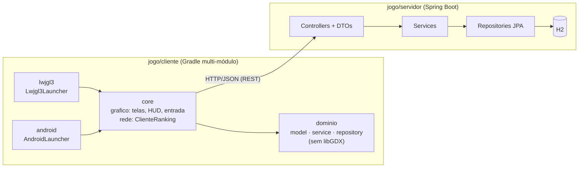

# Arquitetura e decisões técnicas

## Visão geral

O cliente e o servidor são projetos independentes, cada um com o seu Gradle Wrapper. O servidor não conhece nenhuma classe do cliente: os dois conversam só pelo contrato JSON documentado em [API.md](API.md).

## Camadas do domínio (herdadas da Fase 1)

| Pacote | Responsabilidade | Pode depender de |
|---|---|---|
| `model` | Estado do mundo: `Missao`, `Nave`, `Mapa`, passageiros, obstáculos, `Dificuldade`, `Direcao` | nada |
| `service` | Casos de uso e regras do turno: `JogoService`, `Partida`, `GeradorMissao`, `Comando`, `EventoTurno` | `model`, `repository` (interfaces) |
| `repository` | Persistência do ranking local: `RankingRepository` (interface) e `JsonRankingRepository` | `model` |
| `presentation` (só na Fase 2) | Console: `JogoConsole`, `Terminal`, `MapaRenderer` | todas as anteriores |
| `grafico` (cliente) | Telas libGDX: desenho, HUD e tradução de teclas em `Comando` | `dominio` + libGDX |
| `rede` (cliente) | Comunicação com o servidor, atrás da interface `ClienteRanking` | `dominio` + libGDX (`Gdx.net`) |

## Decisões

### D1. Partir da refatoração SOLID da equipe
A Fase 1 é a versão `missao-marte-solid-igor`, que já separa regra e console e tem 39 testes. Reaproveitar esse trabalho é o que o enunciado pede ("evoluir o sistema em vez de reescrever") e respeita a proibição de copiar o código do professor.

### D2. Módulo `dominio` separado do `core`
No template padrão da libGDX, as regras ficam no `core`, junto com a libGDX. Aqui, o `dominio` é um módulo Java puro. Assim, **a separação é garantida pelo compilador**: uma classe de regra que importe `com.badlogic` não compila. Os testes do domínio rodam sem janela e sem OpenGL. O teste `DominioSemLibgdxTest` deixa isso explícito.

### D3. Telas só traduzem entrada e desenham
`TelaPartida` converte a tecla em `Comando` (`MapeamentoTeclas`), chama `partida.executar(...)` e desenha o resultado. Pontuação, colisão, vitória e ranking continuam em `Partida` e `JogoService`, que são as mesmas classes usadas no console. A cor de cada entidade vem de `getSimbolo()`, sem `instanceof`. Isso segue o mesmo OCP do `MapaRenderer` da Fase 1: um novo tipo de entidade aparece na tela sem mudar a tela.

### D4. Ciclo de vida e recursos
`MissaoMarteJogo` cria em `create()` e libera em `dispose()` os recursos compartilhados (`SpriteBatch`, `ShapeRenderer`, `BitmapFont`). `trocarTela` chama `dispose()` da tela anterior. Texturas e sons que forem adicionados devem seguir a mesma regra (o ideal é usar o `AssetManager`).

### D5. Cliente de rede atrás de uma interface (DIP)
As telas usam `ClienteRanking`, nunca HTTP diretamente. `ModoConvidado` permite jogar sem servidor. A implementação real deve usar `Gdx.net.sendHttpRequest`, que é assíncrono e funciona no desktop e no Android, e devolver o resultado à tela com `Gdx.app.postRunnable`, para nunca bloquear a thread de renderização.

### D6. Servidor: DTOs, validação, hash e erro padronizado
As entidades JPA nunca saem pela API. Cada endpoint tem um *record* de requisição validado com Bean Validation e um *record* de resposta. Senhas são guardadas com BCrypt. Todos os erros saem no mesmo formato (`ErroResposta`). Configurações sensíveis ou que mudam de ambiente (porta, endereço, pasta do banco) vêm de variáveis de ambiente.

### D7. Uma pasta por fase até a Fase 2, depois tags
As Fases 0, 1 e 2 ficam em pastas congeladas, porque são versões diferentes do jogo (console, `javac` e Gradle). A partir da Fase 3, cliente e servidor evoluem juntos em `jogo/`. Copiar o projeto inteiro a cada fase, com três pessoas trabalhando em paralelo, geraria conflitos. O fim de cada fase é marcado com uma tag (`git tag fase-03`), e qualquer versão anterior pode ser recuperada com `git checkout fase-03`.

## Antes e depois

| Aspecto | Fase 0 (original) | Fase 1/2 | Cliente gráfico |
|---|---|---|---|
| Onde está a regra do turno | `Main` com 557 linhas, misturada com `Scanner`/`System.out` | `Partida.executar(Comando)` | a mesma `Partida`, sem alteração |
| Entrada | `Scanner` dentro da regra | `Terminal` → `Comando` | `MapeamentoTeclas` → `Comando` |
| Saída | `System.out` dentro da regra | `MapaRenderer`, `PainelInformacoes` | `TelaPartida` (ShapeRenderer + BitmapFont) |
| Ranking | arquivo JSON acessado direto | `RankingRepository` (DIP) | o mesmo repositório + `ClienteRanking` para o global |
| Build | `javac` manual | Gradle Wrapper + JUnit 5 | Gradle multi-módulo |
| Testes | nenhum | 39 / 41 | 36 no `dominio`, sem janela |

## Princípios e padrões, e onde aparecem

| Princípio/padrão | Onde |
|---|---|
| SRP | `Partida` (regra), `GeradorMissao` (montagem do mapa), telas (desenho), `JogadorService` (caso de uso) |
| OCP | `FabricaPassageiro`, `Dificuldade` com parâmetros próprios, cor por símbolo em `TelaPartida` |
| LSP | `Passageiro` e subclasses; `ModoConvidado` e o futuro `ClienteRankingHttp` no lugar de `ClienteRanking` |
| ISP | `Posicionavel` e `Movel`; `RankingRepository` com só 3 métodos |
| DIP | `JogoService` → `RankingRepository`; telas → `ClienteRanking`; `JogadorService` → `PasswordEncoder` |
| GRASP Controller | `JogoService` (console e gráfico) e os `@RestController` (servidor) |
| GRASP Creator / raiz de composição | `Main` (console) e `MissaoMarteJogo` (gráfico) |
| Factory | `FabricaPassageiro` |
| Strategy | implementações de `ClienteRanking` e de `RankingRepository` |
| DTO | `CadastroJogadorRequest`, `JogadorResponse`, `ErroResposta` |
